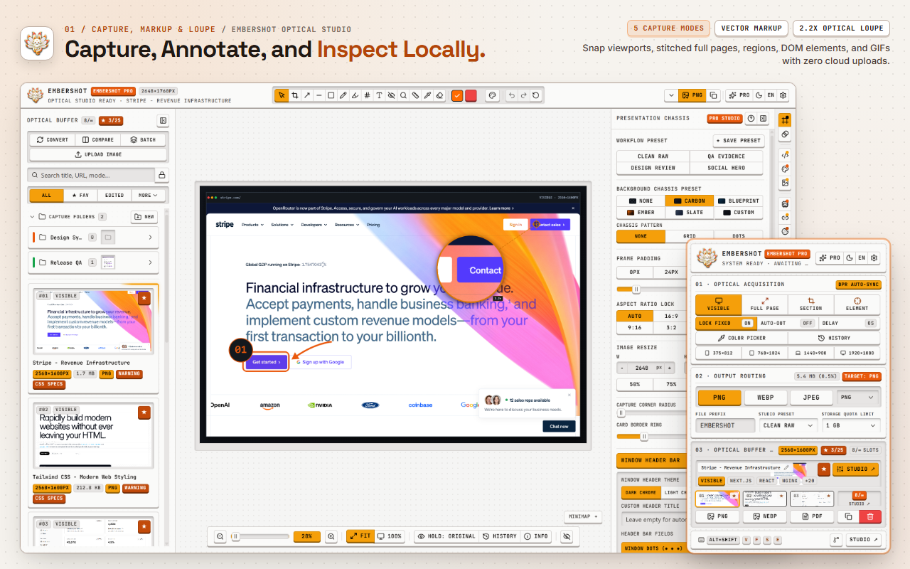
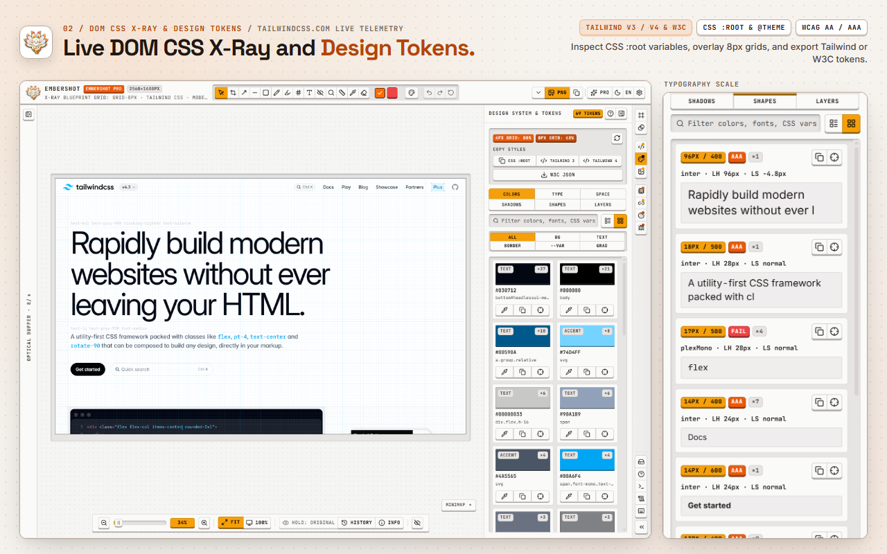

#  Embershot · Optical Capture & QA Studio

**Local-first screenshot, screen video, animated GIF, live CSS restyling, and frontend QA studio for Chrome & Firefox (Manifest V3).**

> **Current Release:** `v1.6.0` · [Privacy Policy](./PRIVACY.md) · [Release Notes](./CHANGELOG.md) · [Security Policy](./SECURITY.md) · [Report an Issue](https://github.com/BuzzFizzer/embershot-public/issues)

---

## Why Embershot?

Embershot captures viewports, stitched full pages (including nested dashboard scrollers), custom regions, unclipped DOM elements, animated GIFs, and local MP4/WebM + Mic screen videos, paired with an in-page **Live CSS & DOM Studio** and an on-device **Optical Studio** for non-destructive markup, automatic PII redaction, background chroma removal, QA Flight Recording, visual diffing, Encrypted Private Vault storage, and 9-format export, with **zero mandatory cloud accounts and zero telemetry trackers**.

---

## Core Capabilities

### 1. Capture Modes, Screen Video Bay & Live In-Page CSS Studio
- **Visible Viewport (`Alt+Shift+V`):** Instant device-pixel-synchronized viewport snap with configurable post-capture routing (`TOAST`, `STUDIO`, `COPY`, `SAVE`, `COPY+EDIT`).
- **Full Webpage Stitch (`Alt+Shift+F`):** Multi-slice scroll & stitch engine with nested dashboard scroller & open Shadow DOM detection, `scroll-snap` neutralization, sticky-header suppression (`Lock Fixed`), lazy-image hydration, and seam-safe animated GIF freezing.
- **Custom Region (`Alt+Shift+S`):** Crosshair selection reticle with aspect-ratio locks, numeric `X / Y / W / H` inputs, and live **Region GIF Recording** straight into the Studio timeline.
- **DOM Element Snap (`Alt+Shift+E`):** Hover and capture any page element or self-scrolling pane unclipped while extracting computed CSS specs and editable text coordinates.
- **Studio Screen, Window & Tab Video Bay:** Record local `1080p`/`720p` screen, window, or tab video with optional system audio and microphone voiceover directly into IndexedDB, trim `IN`/`OUT` points non-destructively, export `MP4`/`WebM`/`GIF`, or **Snap Still Frame** into Studio for vector annotation.
- **Live In-Page CSS & DOM Studio:** Draggable Shadow DOM visual & raw CSS restyling dock with box-model redlines, inline `contenteditable` copy editing, `:hover`/`:focus-visible`/`:active` state simulation, `Ctrl+Z`/`Ctrl+Y` undo, `Copy CSS Patch` / `Copy Tailwind v4`, and 1-click **Compare Before / After** in Studio's Split-Curtain comparator.

### 2. Non-Destructive Optical Studio
- **14 Canvas Tools:** `Select / Pan`, `Crop` (with auto-trim margins), `Arrow` (straight, curved Bezier, elbow), `Line`, `Box / Ellipse`, `Brush`, `Highlighter`, `Step Counter`, `Text Callouts & In-Place Image Text Replacement`, `Optical Loupe & Spotlight`, `Pixel Redline Ruler`, `Multi-Format Eyedropper`, `PII Auto-Shield Redaction`, and `Dual Markup / Pixel Eraser`.
- **Smart-Holes Chroma Key:** Remove solid or shaded backgrounds to transparent alpha (clearing enclosed letter counters automatically) or swap to custom solid backdrops with split-curtain preview and touch-up brushes.
- **Visual Regression Comparator:** Compare any two captures via **Split Curtain**, **Onion Skin**, **Side-by-Side**, or **Pixel Diff** with mismatch metrics and framework stack diffs.
- **Animated GIF89a & Video Timelines:** Scrub, trim In/Out ranges, adjust frame delays, reverse, boomerang, or export lossless/adaptive 255-color GIFs, MP4, and WebM clips.

### 3. Frontend QA Inspectors (`Alt+1` - `Alt+0`)
- **Presentation Framing (`Alt+1`)** & **Chroma Background Removal (`Alt+2`)**
- **DOM CSS Telemetry & X-Ray Grid (`Alt+3`):** Inspect box-model metrics, computed styles, `8px` / `12-col` grids, and WCAG contrast.
- **Design System & Tokens (`Alt+4`):** Audit computed colors, CSS `:root` variables, typography scale, spacing rhythm, shadows, and Z-index layers; copy as CSS, Tailwind v3/v4, or W3C JSON.
- **Page Images, Inline SVGs & SEO (`Alt+5`):** Extract resolved inline SVGs with built-in **SVGO-Lite SVG Minification** (as SVG, Vue SFC, React JSX, Data URI, or `.ZIP`), preview social cards, and check `H1`-`H6` outlines.
- **Tech Stack Detector (`Alt+6`):** Offline signature detection across **1,327 frameworks and tools** in 16 collapsible categories with per-framework detection proof.
- **Page Links & Health Verifier (`Alt+7`):** Audit internal/external/anchor links, verify live HTTP statuses with rate-limit-safe pacing, and highlight broken links on the canvas.
- **Cookies & Web Storage (`Alt+8`):** Inspect masked cookies, `localStorage`, and `sessionStorage` with optional `HttpOnly`/`SameSite` security audits and 6 export formats.
- **Issue Context, 1-Click Ticket Handoff & BYO Cloud Push (`Alt+9`):** Open pre-filled **GitHub, Linear, GitLab, or Jira** tickets with the annotated PNG auto-copied to your clipboard, push directly to your own **Slack / Discord webhooks** or **S3 / Cloudflare R2** bucket (`AWS4-HMAC-SHA256`), or export self-contained **HTML**, **Markdown**, and **JSON** QA bug reports.
- **Session Flight Recorder & Core Web Vitals (`Alt+0`):** Inspect passive `LCP`, `CLS`, `INP`, `FCP`, and `TTFB` vitals plus opt-in secret-scrubbed console errors, failed/slow network requests, and user click breadcrumbs.

### 4. Nine Local Export Formats & Encrypted Private Vault
- **9 Native Encoders:** `PNG`, `WEBP`, `JPEG`, `AVIF`, `BMP`, **4-Layer Editable Hybrid `SVG`**, `GIF`, multi-size `ICO`, and `PDF` (single page, multi-page deck, or stitched walkthrough strip).
- **Zero-Knowledge Private Vault:** Protect sensitive captures and folders at rest in IndexedDB using WebCrypto `PBKDF2` (`SHA-256`) + `AES-256-GCM` encryption with a 4-digit PIN and one-time Recovery Key.
- **9 Interface Languages:** English, Français, العربية (full RTL), Español, Deutsch, 日本語, Português, 简体中文, and 한국어.

---

## Privacy & Permissions Transparency

Embershot is engineered around strict local-first privacy:
- **Zero Cloud Uploads:** Every capture, annotation, redaction, background removal, vault encryption, and format conversion runs 100% locally in your browser.
- **Minimal Install Permissions:** Optional `cookies` and site host permissions (`*://*/*`) are **never** requested at install, only on-demand when you explicitly trigger a deep scan, link check, cookie unlock, or protected GIF download, and can be revoked anytime in **Settings -> Permissions & Access**.
- Read the full [Privacy Policy (PRIVACY.md)](./PRIVACY.md) for complete storage key and permission details.

---

## Support & Feedback

This public repository hosts Embershot's verified **Privacy Policy**, **Release Notes**, **Security Policy**, and **Public Issue Tracker** while the core extension source remains in a private repository.

- **Bug Reports & Feature Requests:** [Open an Issue](https://github.com/BuzzFizzer/embershot-public/issues/new/choose)
- **Privacy Policy:** [PRIVACY.md](./PRIVACY.md)
- **Release History:** [CHANGELOG.md](./CHANGELOG.md)
- **Security Disclosures:** [SECURITY.md](./SECURITY.md)
